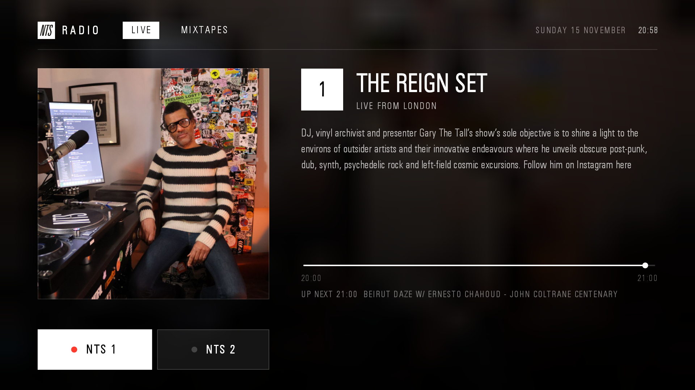
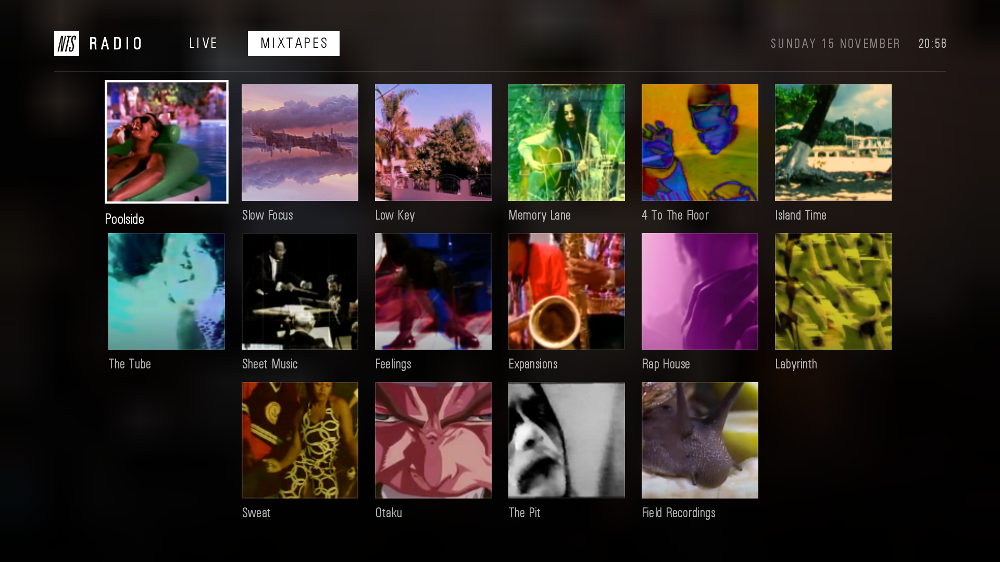

# NTS Radio for Android TV

[NTS Radio](https://www.nts.live/) on the big screen — NTS 1, NTS 2 and the [Infinite Mixtapes](https://www.nts.live/infinite-mixtapes), built for the remote.





## Features

- **Live radio** — NTS 1 and NTS 2 with show title, artwork, timeslot and what's on next.
- **Infinite Mixtapes** — all 16 music-only streams in a clean artwork grid; the playing tile gets a red dot.
- **Remote-first** — D-pad navigation, large focus states, OK to play / pause / switch.
- **Background playback** — audio keeps going from a media session and shows up in Android TV's now playing.
- **Always fresh** — show metadata from the NTS show that is currently scheduled.

## Build

```bash
./gradlew :app:assembleDebug
```

Min SDK 24, targets API 37. The signed release APK ships as `nts-radio-tv-v0.3.apk` in the [v0.3 release](../../releases/tag/v0.3).

---

Unofficial personal project. Streams NTS' public relays; not affiliated with NTS.
